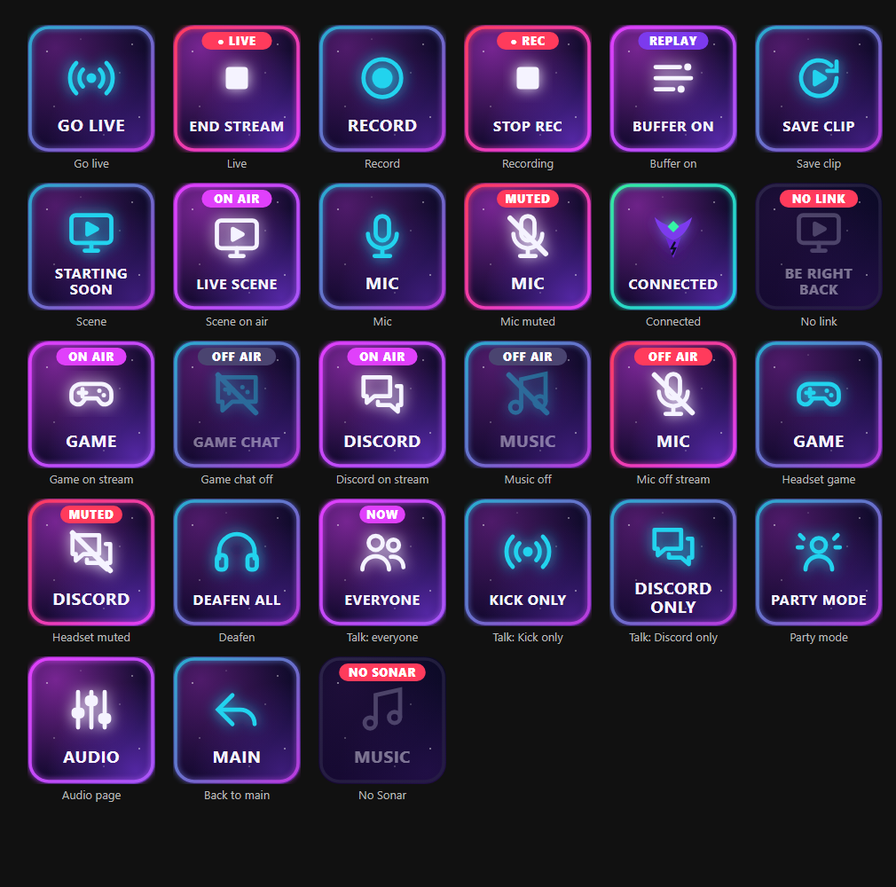

# Phoenix Remote — Stream Deck plugin

Controls **Streamlabs Desktop on a separate streaming PC** from a Stream Deck plugged into the gaming PC, over the local network, and **SteelSeries Sonar on the gaming PC** for audio: what Kick viewers hear, what you hear, and who your mic talks to. See [ADR 0019](../docs/adr/0019-stream-deck-remote-control.md) for why it is built this way.



## What it does

| Key | Action | Feedback |
|---|---|---|
| Go Live / End Stream | `StreamingService.toggleStreaming` — **press and hold** (0.8 s) by default | `● LIVE` red when live, amber while starting/ending |
| Record | `toggleRecording` | `● REC` when recording |
| Replay Buffer On / Off | `startReplayBuffer` / `stopReplayBuffer` | `REPLAY` when running |
| Save Replay Clip | `saveReplay` | Dimmed when the buffer is off, `SAVED` flash |
| Switch Scene | `ScenesService.makeSceneActive` | `ON AIR` on the active scene, `MISSING` if the name is wrong |
| Mute Audio Source | `AudioSource.setMuted` | `MUTED` red |
| Connection Status | Press to reconnect | Connected / Check token / Offline |

Every Streamlabs key shows `NO LINK` when Streamlabs can't be reached, and pressing it then does nothing but flash an alert.

### Audio page (SteelSeries Sonar)

The profile has two pages. **Audio** (bottom-right key on the main page) needs Sonar in **Streamer mode**, where each channel has a *Streaming* mix (sent to the streaming PC, arriving in Streamlabs as "Gaming PC Audio") and a *Monitoring* mix (your headset).

| Row | Keys | What a press does |
|---|---|---|
| Kick viewers hear | Game · Game chat · Discord · Music · Mic | Puts the channel on or off the stream mix (`ON AIR` / `OFF AIR`) |
| You hear | Game · Game chat · Discord · Music · Deafen all | Mutes the channel in your headset (`MUTED` / `DEAFENED`) |
| Mic talks to | ◀ Main · Everyone · Kick only · Discord only · Party mode | The active mode shows `NOW` |

- **Game chat** is Sonar's **Aux** channel. Set a game's *voice chat output* device to "SteelSeries Sonar - Aux" to separate in-game voice from game sound.
- **Discord** is Sonar's **Chat** channel; Discord's input device should be "SteelSeries Sonar - Microphone".
- **Kick only** mutes the mic going to Discord; **Discord only** takes the mic off the stream and stops viewers hearing Discord and game chat; **Party mode** is Everyone plus viewers hearing Discord and game chat.

Sonar's port changes each time it starts; the plugin finds it through SteelSeries GG on `127.0.0.1` and never contacts anything else. Keys show `NO SONAR` if GG isn't running and `CLASSIC` if Sonar is in Classic mode.

## Network

```
Gaming PC (Stream Deck, 192.168.1.126)
   └── ws://192.168.1.119:59650/api/websocket  (JSON-RPC 2.0, token auth)
         └── Streaming PC: Streamlabs Desktop → Settings → Remote Control
```

On the streaming PC, inbound TCP 59650 should be allowed **only from the gaming PC's address**, Private profile only.

## Install

```powershell
.\streamdeck\Install-PhoenixRemote.ps1          # plugin + "Phoenix Remote" profile
.\streamdeck\Install-PhoenixRemote.ps1 -SkipProfile   # plugin only
```

The script restarts the Stream Deck app. The layout comes from [`profile.json`](profile.json); scene and audio-source names there must match Streamlabs exactly. Re-running the script **replaces** the Phoenix Remote profile, so make key changes in `profile.json` rather than in the app if you want them kept.

Then, once: select any Phoenix Remote key → **Streamlabs connection** → paste the token from Streamlabs (Settings → Remote Control → Show details) → **Save & connect**. The token lives in Stream Deck's global settings on this PC only; it is never in this repository.

## Icons

Key art is generated SVG ([`plugin/icons.js`](com.projectphoenix.remote.sdPlugin/plugin/icons.js)), shared by the live plugin and the PNG build:

```powershell
node streamdeck/tools/build-icons.mjs --preview
```

This rasterises the default PNGs with headless Microsoft Edge (no npm dependencies) and writes `preview.html`.

## Troubleshooting

- **Offline / NO LINK** — on the gaming PC: `Test-NetConnection 192.168.1.119 -Port 59650` must report `TcpTestSucceeded : True`. If not, check Streamlabs is running, Remote Control is on, and the firewall rule.
- **Check token** — Streamlabs rejected the token (it changes if you regenerate it). Paste it again.
- **MISSING** on a scene/mute key — the name no longer matches; pick it again from the key's dropdown.
- Plugin log messages appear in `%APPDATA%\Elgato\StreamDeck\logs\StreamDeck.log` prefixed `[PhoenixRemote]`.
